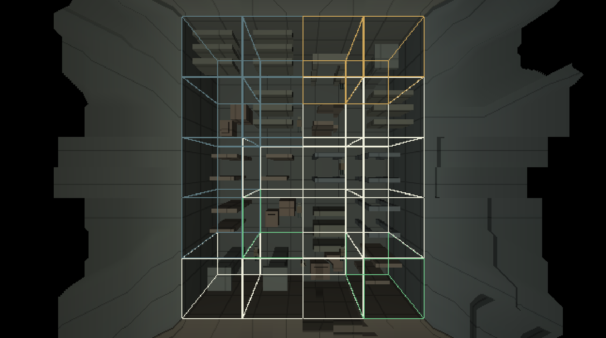

# Arena-fold candidate 2: discrete corruption waves

Separate vanilla JS / Rust WASM / WebGPU prototype. [Candidate 1](../arena-fold/README.md), both accepted engine tests and both title apps are preserved unchanged. This candidate tests a different transition: **architecture never moves or interpolates**. Fixed sector layouts disappear, audition other possibilities, then appear as one final selection.

[Open candidate 2](https://pipebrain.github.io/eigengott/arena-fold-2/) · [Open H tools](https://pipebrain.github.io/eigengott/arena-fold-2/?tools=1)

Locally, serve the repository with `python3 -m http.server 8080` and visit `http://localhost:8080/arena-fold-2/`. Enter captures the mouse; WASD moves, mouse looks, Space jumps, **N starts a corruption wave**, H opens tools and F toggles fullscreen. Tools remain available without Pointer Lock or a physical H key. Touch movement is not implemented.



## What the candidate demonstrates

Twenty 4 × 4 m sectors tile a 16 × 20 × 6 m chamber. Each sector has six fixed architectural recipes: an arch, a monolith, staggered screens, a four-column frame, stepped cover and ceiling ribs. All transforms are fixed catalogue data; the wave never changes their coordinates, scale, shear or rotation. Only complete recipe selection and visibility change.

Each wave selects random instigators using a reproducible seed and cycle index. Activation schedules neighbouring cells probabilistically, with a delay and jitter. The four-neighbour graph has no wrapping edges, visits each cell at most once per wave and limits hop depth. Corruption propagates when a sector starts auditioning, so neighbouring rolls can overlap. A sector that later retains its protected old layout can still conduct the wave onward.

An active sector cycles through random uncommitted recipes and blank slots. Auditions exclude both the proposed final recipe and the old committed recipe, including the safety fallback. Its last selection appears instantly after the audition duration; there is no geometrical tween or moving partition. Committed collision remains intact while previews flicker. Consequently a visually absent wall may still block movement during an audition; the collider overlay exposes this staging rule for evaluation.

Only a validated safe final recipe becomes physical at a fixed simulation boundary. If it would intrude into the player / arms / held-weapon protection margin, the old sector survives instead. Grounded support on existing elevated cover also retains that sector. A rejected replacement does not stop the whole wave, push the player or teleport them. Explicit reset and safety-fixture buttons can reposition the test player.

The structural floor, ceiling and outer collision shell remain sealed and static throughout. Per-sector render faces can disappear, exposing controlled feedback without exposing a physical out-of-bounds hole. Every catalogue entry stays inside its sector with a free perimeter corridor. This is a bounded sector-replacement proof within one chamber, not an arbitrary generated-arena graph conversion or a replacement for the larger benchmark's generation / topology validation pipeline.

## Living loot intermission

The wave ends when all queued / auditioning sectors have settled, followed by the adjustable final settling time. **Every old body clears together at that boundary, including bodies in untouched or protected sectors.** The user explicitly selected global cleanup. Geometry persistence and body lifetime are independent.

Six inert 3D body / gun fixtures demonstrate this contract. They remain visible through the active wave and clear in one event. They have no AI, inventory, equipment swaps or looting interactions. An H option can stage new fixtures at the beginning of each subsequent test intermission; a manual button stages them independently.

Unvisited and protected sectors preserve their exact old recipe. The H grid shows sector ID, state, parent, hop depth, committed epoch and age; age is the current wave index minus the last committed epoch. Old architecture can therefore survive multiple iterations even though every old body is gone. The last 256 diagnostic events are retained in a bounded ring.

Coherence scales root count and neighbour probability by `1 − coherence`. At zero coherence the requested root count and propagation probability apply. A new wave begun at full coherence changes no sectors, while the intermission still settles and clears all old bodies. Roots are selected at wave start; changing coherence mid-wave affects subsequent propagation, not already scheduled work. Chaotic / late-game / static H presets make the comparison immediate. This is a manual prototype control; it is not yet connected to remaining selves or the game's progression rules.

Wave duration is emergent from propagation, auditions and settling time. Fewer affected sectors can produce a shorter intermission. There is no guaranteed minimum loot window or gameplay countdown HUD in this candidate; that policy and tuning remain open for the actual encounter system.

## Rendering and independent controls

The default comparison uses colour afterimages informed by the supplied `render-bug-hall-of-mirrors.mp4` interval at 0:03–0:07. Architectural 0° / 90° hatches, perspective hatches and 45° hatches remain available as stylistic alternatives. The reference video and Build 2 archives remain local inputs; no third-party footage, media or source is included in the test.

The renderer uses fresh depth, current world coverage, a separate clean actor attachment and owned RGBA16F ping-pong history. Bodies, the held weapon and debug lines never enter history; global body cleanup therefore does not leave loot ghosts. Current opaque geometry overwrites feedback normally. No undefined canvas retention or deliberately faulty clear operation is used.

H separates wave playback / step / loop, propagation, slot timing and blank chance, protection, coherence, body fixtures / inspection, feedback, and rendering / diagnostics. Wave and feedback enable / freeze controls are independent. Feedback can be disabled to expose plain black voids. Line width is evaluated at final output resolution, with an exact screen grid when selected. Camera modes include player, free observer and overhead; cutaway ceiling is render-only.

World vertex / index uploads happen only when the discrete visible layout changes. Actor and diagnostic geometry remain separate. The simulation uses fixed 120 Hz steps, fixed 4 MiB WASM memory, bounded meshes / colliders / events, at most two GPU submissions pending, device-loss recovery and hidden-page suspension. Nominal render targets occupy `28 × internal width × height` bytes; persistent GPU buffers total about 576 KiB. Driver padding, swapchain and browser memory are additional.

## Verification

```sh
sh arena-fold-2/tools/build-wasm.sh
node arena-fold-2/tools/check-core.mjs
node arena-fold-2/tools/check-browser.mjs
node arena-fold-2/tools/check-soak.mjs
WAVE_URL=https://pipebrain.github.io/eigengott/arena-fold-2/ node arena-fold-2/tools/check-browser.mjs
```

Rust is pinned to 1.100.0 / `wasm32-unknown-unknown`; there are no runtime frameworks or generated bindings. Core evidence is in `evidence/core.json`. Browser reports and screenshots are first written to ignored `.local/arena-fold-2/`; selected milestone evidence is tracked here separately.

Core checks cover all 120 sector/recipe entries, byte-stable geometry between discrete changes, complete / isolated propagation, random roots and adjacency timing, previews excluding both final choices, global body cleanup with nineteen untouched sectors, multi-cycle old geometry, 30 / 60 / 120 / 240 FPS event parity, independent body / weapon vetoes, retained elevated footing, pause / step, 7,200 randomized movement / look steps and fixed capacities. Matched samples over 24 seeds affected 446, 113, 41 and zero sectors at coherence 0, 0.5, 0.9 and 1 respectively; those are sample totals, not a prescribed progression curve.

Browser checks cover native mouse capture / H tools, GPU history exclusion for all actors, all-sector blank auditions, independent black voids, exact mixed hatch grids at two resolutions, global mesh cleanup, coherence presets, guard fixtures, colour / architectural / overhead views, step, resize, device loss, freeze / resume and missing APIs. The 30-second run progressively increases coherence while checking sealed gameplay, completed waves, surviving old sectors, resource counts and sampled CPU / GPU timing. These bounded desktop results do not establish physical cross-device acceptance or a general driver-memory leak proof.

The recorded [browser run](evidence/browser-verification.json) passes 16 groups. The [30-second run](evidence/soak-verification.json) completed seven waves near 60 display-limited FPS, with some geometry reaching age five. At 360 internal height / 1376 × 768 output, final host CPU p95 was about 0.7 ms; sampled GPU median / p95 / maximum were about 0.77 / 0.80 / 0.85 ms. Retained JavaScript heap increased about 109 KiB after garbage collection while owned resource counts stayed fixed. These are measured local samples, not guaranteed budgets.
