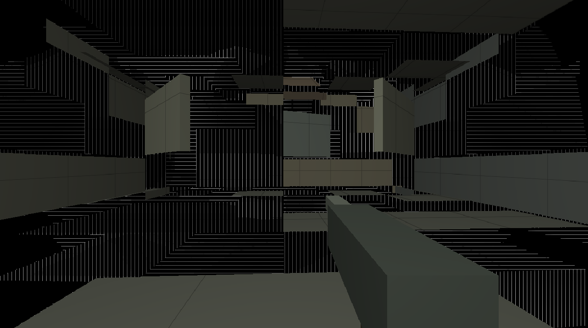

# Continuous arena fold experiment

Separate vanilla JavaScript / Rust WebAssembly / WebGPU test. The accepted engine, larger-arena benchmark, DOS-maze and vector-labyrinth apps are unchanged.

Open [the test](https://pipebrain.github.io/eigengott/arena-fold/) or [its tools](https://pipebrain.github.io/eigengott/arena-fold/?tools=1). For a local preview, serve the repository over localhost, for example `python3 -m http.server 8080`, then visit `http://localhost:8080/arena-fold/`. WebGPU requires a compatible browser and GPU.

Enter captures the mouse. WASD moves, mouse looks, Space jumps, **N folds / reverses**, **H opens tools**, F toggles fullscreen, and Escape releases the mouse. Open tools also works without Pointer Lock or a keyboard. Touch movement is not implemented. Geometry starts at rest; trigger it with N or the H-menu button.



## Physical fold

A fixed 16 × 20 × 6 m chamber contains two hinged wall leaves, one translating / rotating partition and one hinged ceiling leaf. Six overlapping static collision slabs permanently enclose it. Moving partitions do not replace that enclosure. Render-only face removal never changes collision.

The fixed 120 Hz simulation sweeps a player capsule and a conservative held-weapon / arms capsule against oriented boxes. A fold proposal checks the entire phase interval, including large manual scrubs and reversals. It bounds every point's motion using translation plus angular travel, then recursively certifies capsule/box separation. Uncertain intervals fail closed. The player's swept translation is included by conservatively expanding the protected proxies. One blocked panel holds the complete fold; it never pushes or relocates the player.

The default additional moving-geometry margin is 0.20 m. When a player has approached a stationary panel inside that margin, subsequent geometry must preserve the current separation rather than demand an impossible instantaneous clearance increase. Static supporting-floor contact remains allowed. Explicit **Reset chamber** and the two fixture buttons reset the geometry and player together; ordinary folds do not teleport either.

H controls geometry enablement, fold / reverse, pause / resume, guarded phase scrubbing, single steps, looping, duration and margin. Weapon and body fixtures demonstrate independent reasons for a safety hold. Observer cameras leave the physical player protected in place. Collider and protected-volume overlays support inspection; there is no safety-disable switch.

This is a bounded moving-partition proof, not arbitrary interpolation between generated arena graphs. Interior partition intersections are not treated as a sealed manifold or resolved as rigid-body contacts. Future arena replacement still needs the candidate construction, topology and activation checks in the engine plan. Combat, looting time, final-opponent behavior and full arena-law changes remain outside this experiment.

## Controlled void feedback

Every frame renders current world coverage and fresh depth normally. The body / weapon and debug overlays use a separate clean attachment with writes to world colour disabled. They never enter the retained history, and actual geometry keeps normal depth testing.

Two owned `rgba16float` history textures alternate reading and writing. There is no sampling from a texture while it is being rendered into, no dependence on previous swapchain contents, and no deliberately broken clear operation. Newly exposed pixels can retain and advect past world colour. Current opaque world pixels immediately overwrite history. Disabling feedback leaves uncovered pixels black.

The default architectural interpretation turns the retained colour field into rectilinear lines, evaluated at the **final output resolution** so internal resolution changes and feedback stretching do not thicken the strokes. Screen-grid mode has constant pixel pitch; world-plane mode uses a fixed 0.5 m hatch period and constant pixel stroke width. A 45° screen hatch is also available. The physical world keeps a muted green / brown palette, with an independent monochrome option; void lines default to monochrome.

World-anchored mode intersects view rays with the fixed chamber envelope and reprojects those world anchors through the previous camera. Screen-space colour afterimages provide a simpler comparison. These are stylized room-envelope anchors, not per-object motion vectors: moving-object disocclusion and observer views can produce deliberate afterimages rather than physically accurate temporal reconstruction.

Feedback enablement, drift / decay freeze, half-life, stretch speed, branch bias, hatch coordinates / pitch / width, seed, palette, pass inspection and history clear are independent of geometry playback. Openings can follow the fold or be held at a manual amount. Frozen feedback still accepts current opaque world pixels and camera reprojection. Floating-point history avoids the visible decay floor caused by repeatedly rounding long half-lives into 8-bit colour. Resize, camera changes, resume and device recovery reset stale history.

The Reddit player could not initially be retrieved. The user subsequently supplied `render-bug-hall-of-mirrors.mp4`; sampled frames across the requested **0:03–0:07** interval were inspected. They show repeated world contours stretching through exposed space while the current scene remains legible. Colour-afterimage mode offers the closer comparison; architectural mode deliberately interprets that effect through the title's rectilinear line treatment. The reference footage and newly supplied Build 2 archives remain local reference inputs, separate from the published runtime and tracked source. No exact reconstruction of the original rendering fault is claimed.

## Resources and lifecycle

- Fixed **4 MiB WASM memory**, approximately 31 KiB compiled module; no runtime allocator or framework.
- Ten world boxes and ten placeholder body / weapon boxes: 240 world vertices, 360 world indices, and the same body counts. Debug geometry is bounded separately.
- Three render passes: scene, history feedback, final composition. No shadows or MSAA. GPU timestamp support is optional.
- At most two submitted frames pending. No per-frame GPU readback in normal operation. Physics remains fixed-step across render rates; hidden-page time is discarded on resume.
- Nominal render-target storage is **28 × internal width × height bytes**: two RGBA8 attachments, two RGBA16F histories and a depth24plus target budgeted at four bytes/pixel. This excludes driver padding / overhead, swapchain storage, and browser memory. Persistent buffers total about 256 KiB.
- Explicit destruction on resize / disposal, device-loss recovery retaining physical state, retry after initialization failure, and a tools fallback when Pointer Lock is absent.
- H exposes internal resolution, pixel-ratio cap, camera, diagnostics and copied reports. Test-only WASM / history readback access is enabled with `?test`; it is not needed for gameplay.

## Verification

```sh
sh arena-fold/tools/build-wasm.sh
node arena-fold/tools/check-core.mjs
node arena-fold/tools/check-browser.mjs
node arena-fold/tools/check-soak.mjs
FOLD_URL=https://pipebrain.github.io/eigengott/arena-fold/ node arena-fold/tools/check-browser.mjs
```

Rust is pinned to 1.100.0 with the `wasm32-unknown-unknown` target. The build is freestanding, optimized, fixed-memory and panic-aborting. The browser check uses the existing development-only Chrome helper; it adds no runtime dependency. Core evidence is in `evidence/core.json`; local screenshots / browser reports go to ignored `.local/arena-fold/`.

Core checks cover 32,000 box-corner motion bounds, full forward / reverse trajectories, endpoint-clear tunnelling cases, body and weapon holds / release, 30 / 60 / 120 / 240 FPS parity, rendered body triangle coverage by convex protected volumes, 14,400 randomized movement / look steps, finite input handling and fixed capacities. Browser checks compare history with body / debug visibility changed, test black voids and long decay, verify independent controls, examine final-pixel line grids across resolutions, and exercise resize, GPU recovery, page freezing, native mouse capture, missing APIs and a bounded animated run.

The recorded [browser checks](evidence/browser-verification.json) pass all 15 groups. The [30-second run](evidence/soak-verification.json) completed six fold reversals near 60 display-limited FPS. Host CPU p95 was about 0.4 ms; sampled GPU totals had a median of 0.84 ms, p95 2.93 ms and maximum 4.28 ms at 360 internal height / 1376 × 768 output. Retained JavaScript heap increased about 84 KiB after explicit garbage collection; owned resource counts stayed fixed. These are local bounded observations, not a guaranteed frame budget, physical cross-device acceptance or a general native-memory leak proof. The core and Pages workflows rebuild and verify the checked-in WASM before deployment; GPU browser verification is local.
