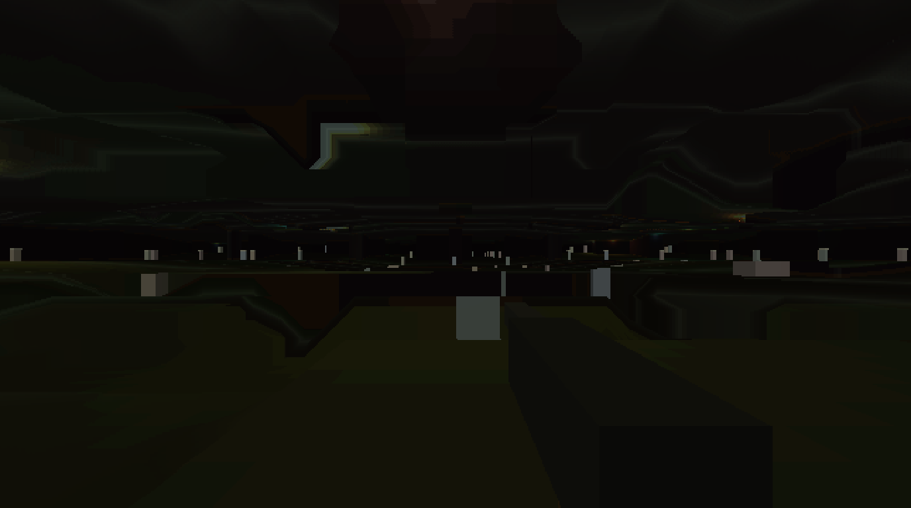

# Procedural collapse / return test

Separate vanilla JavaScript, Rust WebAssembly and WebGPU integration of the accepted candidate 2 direction with the benchmark's real procedural arenas. The small baseline, larger benchmark, both earlier candidates and title screens remain unchanged.

[Open test](https://pipebrain.github.io/eigengott/arena-sweep/) · [Open H tools](https://pipebrain.github.io/eigengott/arena-sweep/?tools=1)

Serve the repository with `python3 -m http.server 8080`, then open `/arena-sweep/`. Enter captures the mouse; WASD moves, mouse looks, Space jumps, **N starts a sweep**, H opens tools and F toggles fullscreen. Tools work without mouse capture; touch movement is not implemented.



## Transition contract

The wave captures the player's **starting XY**, equipped body and gun. Its origin stays fixed while the player moves. Clumps containing either physical proxy plus the capture margin remain untouched. If the player straddles sector or clump lines, the protected union includes both sides; no artificial field is placed on internal protected seams.

The player can move and loot inside that protected space. Thin collision fields bound its outer edges. Attempting to leave triggers a transparent static effect and a spatial contact sound. H can expose every field for inspection. Enemy fixtures acquire their own fields as the return wave stages them. Nothing pushes or teleports the player during a normal sweep.

Prepared clumps disappear near-to-far in an expanding XY sweep, then appear far-to-near on the return. Architecture is never animated between positions. Coherence retains a reproducible proportion of old clumps. At full coherence, no architecture changes, but the intermission and shared release still complete.

Old body fixtures disappear **with the deletion of their owning clump**. Bodies in protected or other surviving clumps clear at final return. Looting remains open through preparation, collapse and reconstruction. After all selected clumps have returned or safely retained their old version, one fixed simulation boundary clears remaining bodies, closes looting and releases **all player and staged enemy forcefields together**.

These are inert body/enemy fixtures: equipment exchange, actual encounter completion, enemy AI and combat are not implemented. Each test sweep stages fresh illustrative old bodies. There is no numerical gameplay HUD. Pause freezes the wave while movement remains available; single-step advances one wave tick. Abort restores current safe geometry and releases fields without resurrecting deleted bodies.

## Scope and safety

The 75 m / 572-sector and 196 m / 2,136-sector workloads use the accepted procedural generator, geometry validation, BVH, baked coarse lighting and optional Quake-referenced movement. Default clumps are four cells wide; H exposes widths one through eight, applied on arena reload. At default width the workloads have 49 / 169 clump slots.

This first integration keeps **structural floors, ceilings, ramps and opening boundaries compatible and unchanged**. It replaces bounded interior column/cap recipes and per-clump material generations. Hidden structural faces retain physical collision throughout the visual collapse. The player cannot reach those hidden regions because of the protected field boundary. This is not yet an arbitrary topology, portal, floor-height or whole-arena replacement system.

Interior recipes remain within validated flat cells with sufficient headroom. Their physical cap envelope is conservative. Rust atomically installs the complete overlay only after checking the actual player's body and held gun; a rejected insertion retains the old safe recipe. No fallback spawn is used by a sweep. Explicit arena reload, movement-profile changes while idle and the sector-line fixture are separate inspection operations that may reposition the player.

The baseline body radius is 0.34 m. The structural gun capsule is 0.20 m with relief padding; the overlay uses a conservative 0.30 m gun envelope. Rotation is subdivided and checked as well as translation. Quake movement retains its larger body envelope. The WASM allocation is fixed at 32 MiB; 2,048 overlay boxes and 2,401 clump slots bound the supported workloads.

## Rendering, sound and preparation

The base GPU mesh stays resident. Packed vertex ownership selects per-clump visibility and material generation through one small state buffer. Each wave worker prepares compact current/proposed interior meshes; it does not transfer a full 32 MiB world image for each clump. At most the current and proposed interior meshes accompany the one active base arena. Surviving recipes are compacted into the next preparation, avoiding a chain of historical full arenas.

Initial arena generation and baking run in a worker. Memory copies and GPU uploads use bounded chunks under an adjustable nominal 1 ms/frame host preparation budget. An explicit new arena can be prepared while the active one remains playable. Cancellation, stale results and preparation failure preserve the active world. Physics and transitions use fixed 120 Hz steps; GPU submissions are capped at two pending frames. Hidden pages suspend without accumulated catch-up. GPU recovery restores the active world and wave state.

Fresh depth, real current-surface coverage and two owned RGBA16F textures implement controlled **screen-space** void feedback. It does not rely on undefined swapchain contents or the older chamber's box-based reprojection. Current geometry overwrites history. Player, weapon, bodies, enemy fixtures and transparent fields render into a clean actor attachment and never enter feedback. Architectural 0°/90° and 45° output hatches are optional; line width and pitch are evaluated at final pixel resolution.

Transition light is a bounded shadowless radial pulse; base lighting is reused because structural geometry and emitters are unchanged. New interior fixtures cast no dynamic shadows. Full neighbour-dependent rebaking for changing occlusion/topology remains future work.

Native Web Audio uses eight reusable HRTF panners and generated sound buffers. Ordered simulation events provide actual clump positions and times for collapse, return, turnaround, release and field contact. Excess ordinary cues coalesce; turnaround/release have priority. Pause, hide, abort and recovery cancel stale scheduled sounds. Sound is enabled by a browser user gesture. The procedural cues are an authoring starting point, not final game assets.

H groups arena preparation, wave playback/coherence, protected space/bodies/enemies, spatial sound/light, independent void feedback, and view/performance/diagnostics. The downloaded reference video and Build 2 archives are local inputs and are not shipped.

## Verification

```sh
sh arena-sweep/tools/build-wasm.sh
node arena-sweep/tools/check-core.mjs
node arena-sweep/tools/check-browser.mjs
node arena-sweep/tools/check-soak.mjs
SWEEP_URL=https://pipebrain.github.io/eigengott/arena-sweep/ node arena-sweep/tools/check-browser.mjs
```

The compiler is pinned to Rust 1.100.0 / `wasm32-unknown-unknown`; no runtime frameworks or generated bindings are used. Core checks cover both arena sizes, sealed geometry and cell ownership, four-clump intersection capture, 7,680 directional containment steps, both movement profiles at clump widths 1/2/8, rotating gun clearance, outward/inward ordering, per-clump body removal, staged enemy fields, simultaneous release, surviving geometry, invalid atomic overlays and 30/60/120/240 FPS parity. Procedural audio samples are checked for finite, non-silent bounded signals.

Browser tests check actual WebGPU compilation and rendering, native entry/H/audio activation, field/history isolation through GPU readback, worker loading/cancellation, both feedback interpretations, resize, freeze/resume, in-wave GPU loss, repeated large-arena sweeps and missing APIs. A separate 30-second run samples frame/CPU/GPU timing and bounded resources across increasing coherence. Evidence is recorded here; full local logs are under ignored `.local/arena-sweep/`.

These are bounded desktop Chrome/Metal checks. Spatial sound has been checked for activation, scheduling and positional data; subjective sound design, physical cross-device acceptance and arbitrary procedural topology replacement remain unverified.


The recorded [browser check](evidence/browser-verification.json) passes 11 groups. The [30-second large-arena run](evidence/soak-verification.json) completed 11 sweeps near 60 display-limited FPS, with some protected/surviving geometry reaching age 12. Final host CPU p95 was 2.3 ms; sampled GPU median/p95/maximum were 1.22/1.62/1.63 ms at 360 internal height and 1376 × 768 output. Active arena GPU data stayed at 7,268,480 bytes; fixed actor buffers, render targets, driver overhead and the swapchain are additional. Retained JS heap grew about 524 KiB while the bounded event history and repeated-wave data filled. This is a short stability sample, not a general leak proof or a guaranteed performance budget.
